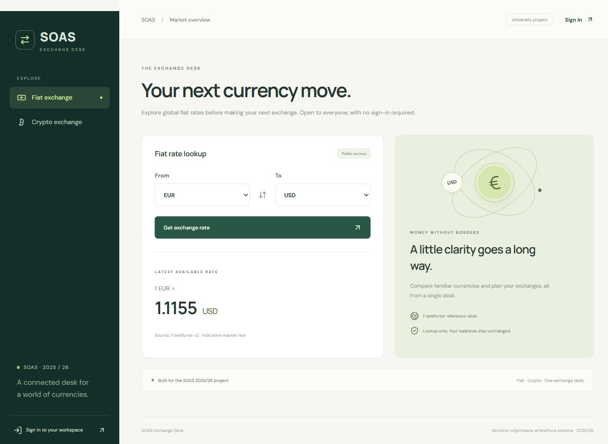

# SOAS Exchange Desk

My project for **Servisno orijentisana arhitektura sistema (2025/26)**. It’s a demo exchange where you can look up fiat and crypto rates, convert currencies, and trade using a virtual bank account and crypto wallet.



## Run with Docker

With Docker Desktop running in Linux container mode, open a terminal in the repository root and run:

```powershell
docker compose up -d --build --wait --wait-timeout 300
```

- [Exchange Desk](http://localhost:5173) opens the React app.
- [Eureka](http://localhost:8761) shows the registered services.
- [Gateway health](http://localhost:8765/actuator/health) shows whether the API gateway is ready.

Give Eureka and demo account provisioning a moment after the first start. If the demo login still fails, check `docker compose logs users-service bank-account crypto-wallet`. To stop the stack, run `docker compose down`. The databases are in memory, so restarting a database service resets its data.

## Demo accounts

| Role | Email | Password | Starting balance |
|---|---|---|---|
| OWNER | `owner@soas.local` | `Owner123!` | — |
| ADMIN | `admin@soas.local` | `Admin123!` | — |
| USER | `user@soas.local` | `User123!` | EUR 10,000 and ETH 2 |

Use the **USER** account to try conversion and trading. New users start with EUR 0 in their bank account and ETH 0 in their wallet. An **ADMIN** can add currencies or change balances. The system allows one **OWNER**, who can delete users and their associated bank accounts and wallets.

| Action | OWNER | ADMIN | USER | Guest |
|---|---|---|---|---|
| Look up rates | Yes | Yes | Yes | Yes |
| Manage users | Create, view, update and delete | View users, create and update USER accounts | — | — |
| View or manage balances | — | View all, add and update holdings | View own only | — |
| Convert fiat or trade crypto | — | — | Yes | — |

## Services

The backend uses Java 17, Maven, Spring Boot 4, Spring Cloud, OpenFeign and H2. The frontend uses React, TypeScript and Vite. Eureka handles service discovery, and the browser sends its API requests through the gateway. The users, bank and wallet services each have their own H2 database.

| Module | Port | What it does |
|---|---:|---|
| `naming-server` | 8761 | Eureka service registry |
| `api-gateway` | 8765 | Routes requests, checks Basic Auth and forwards the verified identity |
| `users-service` | 8770 | Manages users and roles, hashes passwords with BCrypt, and coordinates account and wallet provisioning |
| `currency-exchange` | 8000 | Gets fiat rates and supported currencies from Frankfurter |
| `currency-conversion` | 8100 | Converts fiat and updates the bank account |
| `bank-account` | 8200 | Stores fiat balances and their operation history |
| `crypto-wallet` | 8300 | Stores crypto balances and their operation history |
| `crypto-exchange` | 8400 | Gets crypto rates from Coinbase |
| `trade-service` | 8600 | Coordinates crypto swaps, buys and sells |
| `frontend` | 5173 | React app |

`service-library` contains shared DTOs and Feign clients. `util` contains validation, internal authentication and JSON error handling. Bank and wallet operations use local transactions. For trades that span both services, the trade service tracks completed steps and attempts to reverse them if a later step fails. Rate lookups can retry up to three times. Balance updates are sent once.

Fiat options come from Frankfurter’s currency catalog. The crypto options are BTC, ETH, SOL, ADA, XRP, LTC, DOGE and BCH. Trades involving fiat other than EUR or USD use USD as an intermediate currency. Quotes depend on provider availability. [Frankfurter](https://frankfurter.dev/) · [Coinbase exchange rates](https://docs.cdp.coinbase.com/coinbase-app/track-apis/exchange-rates)

## API endpoints

Use the gateway on port **8765**. Protected requests use HTTP Basic Auth with the demo email and password. Replace `{id}` or `{email}` with the real value and URL-encode it when needed.

| Method | Functional URL | Access / purpose |
|---|---|---|
| GET | `http://localhost:8765/auth/me` | Any authenticated role, current identity |
| GET | `http://localhost:8765/users` | OWNER / ADMIN, user directory |
| GET | `http://localhost:8765/users/{id}` | OWNER / ADMIN, user details |
| POST | `http://localhost:8765/users` | OWNER, or ADMIN creating a USER |
| PUT | `http://localhost:8765/users/{id}` | OWNER, or ADMIN updating a USER without changing the role |
| DELETE | `http://localhost:8765/users/{id}` | OWNER, with account and wallet cleanup |
| GET | `http://localhost:8765/bank-accounts` | ADMIN, all accounts |
| GET | `http://localhost:8765/bank-accounts/me` | USER, own fiat account |
| GET | `http://localhost:8765/bank-accounts/{email}` | ADMIN or matching USER |
| POST | `http://localhost:8765/bank-accounts/holdings` | ADMIN, add a new holding |
| PUT | `http://localhost:8765/bank-accounts/holdings` | ADMIN, set an existing total balance |
| GET | `http://localhost:8765/crypto-wallets` | ADMIN, all wallets |
| GET | `http://localhost:8765/crypto-wallets/me` | USER, own wallet |
| GET | `http://localhost:8765/crypto-wallets/{email}` | ADMIN or matching USER |
| POST | `http://localhost:8765/crypto-wallets/holdings` | ADMIN, add a new holding |
| PUT | `http://localhost:8765/crypto-wallets/holdings` | ADMIN, set an existing total balance |
| GET | `http://localhost:8765/currency-exchange?from=EUR&to=RSD` | Public fiat rate |
| GET | `http://localhost:8765/currency-exchange/assets` | Public supported fiat codes |
| GET | `http://localhost:8765/crypto-exchange?from=BTC&to=ETH` | Public crypto rate. EUR and USD also accepted |
| GET | `http://localhost:8765/crypto-exchange/assets` | Public supported crypto codes |
| GET | `http://localhost:8765/currency-conversion?from=EUR&to=RSD&quantity=100` | USER, mutates fiat holdings |
| GET | `http://localhost:8765/trade-service?from=EUR&to=BTC&quantity=100` | USER, buys BTC with EUR |
| GET | `http://localhost:8765/trade-service?from=ETH&to=BTC&quantity=0.01` | USER, crypto → crypto |
| GET | `http://localhost:8765/trade-service?from=RSD&to=BTC&quantity=100` | USER, RSD → USD conversion → BTC |
| GET | `http://localhost:8765/trade-service?from=ETH&to=EUR&quantity=0.01` | USER, crypto → fiat |
| GET | `http://localhost:8765/trade-service?from=ETH&to=RSD&quantity=0.01` | USER, ETH → USD → RSD conversion |
| GET | `http://localhost:8765/actuator/health` | Public Gateway health |

The assignment specifies GET for currency conversion and trading. Both endpoints **change balances**, so send each request once. Successful responses include the resulting bank account or wallet and an operation ID.

**Create a user**

```json
{"email":"new@soas.local","password":"Password123!","role":"USER"}
```

For a user update, send the email and role with `"password": null` to keep the current password.

**Add or update a holding**

```json
{"email":"user@soas.local","currency":"USD","amount":"1000.00"}
```

Use POST for a new currency and PUT to set the total balance of an existing holding.

## Run from source

Use JDK 17, Maven and Node.js 22.12 or newer. If Compose is running, stop it with `docker compose down` to free the ports. Start the backend from the repository root:

```powershell
mvn clean package
.\scripts\start-local.ps1
```

Start the frontend in a second terminal:

```powershell
cd frontend
npm ci
npm run dev
```

On Linux or macOS, start the backend with `bash scripts/start-local.sh`. Stop it with `.\scripts\stop-local.ps1` on Windows or `bash scripts/stop-local.sh` on Linux and macOS. Stop the frontend with Ctrl+C. For startup issues, check `mvn -version` for Java 17 and look in `.runtime/` for service logs.

## Tests

```powershell
mvn test
cd frontend
npm ci
npm test
npm run build
```

With the full app running and the demo accounts enabled, run `.\scripts\smoke-test.ps1` from the root, or `bash scripts/smoke-test.sh` on Linux or macOS. The smoke test creates a temporary user, exercises the main flows and deletes the user when finished. It uses live rates.

The verified run passed 117 backend tests, 18 frontend tests and 14 smoke test groups.

## Docker Hub

All nine backend images are public under `davidsubotinds` with the `latest` tag.

| Service | Published image |
|---|---|
| naming-server | [davidsubotinds/soas-naming-server:latest](https://hub.docker.com/r/davidsubotinds/soas-naming-server/tags) |
| users-service | [davidsubotinds/soas-users-service:latest](https://hub.docker.com/r/davidsubotinds/soas-users-service/tags) |
| currency-exchange | [davidsubotinds/soas-currency-exchange:latest](https://hub.docker.com/r/davidsubotinds/soas-currency-exchange/tags) |
| currency-conversion | [davidsubotinds/soas-currency-conversion:latest](https://hub.docker.com/r/davidsubotinds/soas-currency-conversion/tags) |
| bank-account | [davidsubotinds/soas-bank-account:latest](https://hub.docker.com/r/davidsubotinds/soas-bank-account/tags) |
| crypto-wallet | [davidsubotinds/soas-crypto-wallet:latest](https://hub.docker.com/r/davidsubotinds/soas-crypto-wallet/tags) |
| crypto-exchange | [davidsubotinds/soas-crypto-exchange:latest](https://hub.docker.com/r/davidsubotinds/soas-crypto-exchange/tags) |
| trade-service | [davidsubotinds/soas-trade-service:latest](https://hub.docker.com/r/davidsubotinds/soas-trade-service/tags) |
| api-gateway | [davidsubotinds/soas-api-gateway:latest](https://hub.docker.com/r/davidsubotinds/soas-api-gateway/tags) |

To build and publish the backend images under your own Docker Hub account, run `.\scripts\publish-docker.ps1 -Username 'your-docker-id'`. If an upload is interrupted after the build, rerun with `-Resume` to use the existing images and saved Docker login.

---

David Subotin · SOAS 2025/26
