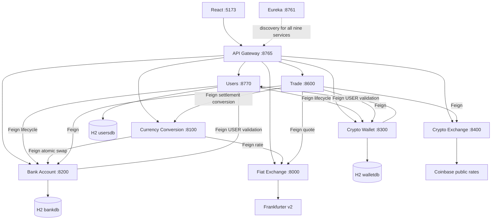

# Architecture and defense notes

All executable applications, including the naming server itself, register with Eureka. The two library modules do not run or register. No service reads another service's persistence model.

## Contracts and authentication

`service-library` defines DTO records, the exact OWNER/ADMIN/USER role enum, supported assets and seven Feign client interfaces. Persistence entities belong only to users, bank and wallet. Constructor injection and controller/service/repository boundaries keep each module independently explainable.

The Gateway's reactive Spring Security Basic Auth manager calls `POST /internal/auth/validate` on users-service using a load-balanced WebClient. BCrypt validation occurs in users-service. The Gateway obtains `{id,email,role}` and never retrieves password hashes. Security matcher rules reject unauthorized roles before routing; controllers enforce finer rules such as USER ownership and ADMIN's inability to create ADMIN/OWNER or delete users.

The Gateway removes Authorization, X-User-Email, X-User-Role, X-Internal-Key and X-Gateway-Key from incoming routed requests. It adds the verified user identity and Gateway key itself. Services accept protected public paths only with that key. Internal paths use a separate key injected into Feign calls by the common request interceptor. No internal route exists at Gateway. Docker publishes only Gateway, Eureka and the frontend.

Development keys have obvious defaults in `.env.example`; they are demo configuration, not production credentials. The shared internal key is a trust boundary among this project's services, rather than a per-service authorization system. H2 consoles are disabled. Actuator exposes health/info only, with details hidden by default. Eureka is a development/defense dashboard.

## User lifecycle

User methods serialize lifecycle changes in the single users-service instance. Repository saves commit before cross-service provisioning so bank/wallet can validate ownership via Feign without a transaction deadlock. A `ready` flag temporarily prevents Basic login while provisioning or migration is incomplete.

* **Create USER:** save a locked USER → bank EUR 0 → wallet ETH 0 → mark ready. Failure attempts cleanup in both services before removing the new row.
* **Delete USER:** snapshot holdings → lock user → delete both services' data → delete user. Failure restores both snapshots before unlocking.
* **Change email:** snapshot → lock → rename holdings through both APIs → save new email → unlock. Failure removes any new-email holdings, restores old snapshots and restores user fields.
* **USER → ADMIN/OWNER:** snapshot → lock → remove holdings → save role → unlock. Failure restores snapshots.
* **ADMIN/OWNER → USER:** save locked USER → provision defaults → unlock. Failure removes defaults and restores the previous role and email.

Cleanup failures are reported explicitly and logged; a user can remain locked for administrator recovery. No “success” is returned for an incomplete lifecycle. Email has a unique database constraint. OWNER has a separate nullable unique `ownerSlot`, so database uniqueness also prevents a second OWNER; role changes update that slot.

Demo OWNER and ADMIN are seeded first. A scheduled provisioner waits for account services to be discoverable, creates the demo USER through the same lifecycle path and applies idempotent demo funding. This avoids a circular startup dependency. Other USER creations never receive demo funding.

The provisioner probes both downstream account APIs before creating the demo USER. If an earlier startup attempt left that specific demo account pending, it resumes the idempotent EUR/ETH provisioning before unlocking it. Funding retries reuse the same operation IDs, so a partial funding failure cannot double-credit the demo account. This startup behavior has dedicated regression tests.

## Holdings and arithmetic

Bank and wallet use their own H2 database, each with `holdings` and `operations` tables. A logical owner can hold multiple assets; `unique(email,currency)` prevents duplicate holdings. `@Version` detects concurrent balance updates. A conflict rolls back the local transaction and returns a clean error instead of silently overwriting money.

Every amount and rate is `BigDecimal`. Quantities must be positive, balances nonnegative, and arithmetic rounds to 12 decimal places using HALF_EVEN. External rates must be positive. All supported codes are explicitly validated and normalized. Source holdings must exist; a credit or swap creates a missing target holding.

Stored amounts permit up to 26 integer digits and 12 fractional digits, matching the H2 DECIMAL(38,12) columns. Overflow is rejected before persistence and leaves the old balance unchanged.

An internal swap deducts and credits both currencies inside **one local JPA transaction**. An adjustment changes one currency in a local transaction. Each operation saves its exact per-currency deltas under a unique operation ID in the same transaction. Repeating an ID with the same email and deltas has no extra effect; using it with different data or after undo is rejected. Undo applies inverse deltas atomically and marks the operation undone. An unknown or already-undone operation is a no-op.

## Conversion and trade

Conversion validates source funds and quotes before calling bank's atomic swap. Public conversion uses the current authenticated USER. Internal conversion accepts the trusted Trade service's email, pre-fetched rate and operation ID to use the same quote throughout the saga.

Trade validates assets, funds and all rates before mutation. Only rate reads are retried (up to 3 attempts, with 100ms/200ms backoff). Mutation calls are never automatically retried. The allowed assignment fault-tolerance mechanism is retry; no Resilience4j/Boot-version integration is needed.

| Mode | Mutations |
|---|---|
| Crypto → crypto | Atomic wallet swap |
| EUR/USD → crypto | Bank debit → wallet credit |
| Other fiat → crypto | Conversion to USD → bank USD debit → wallet credit |
| Crypto → EUR/USD | Wallet debit → bank credit |
| Crypto → other fiat | Wallet debit → bank USD credit → conversion USD to final fiat |

Each attempted mutation registers its undo action **before** calling the downstream API, so a lost response can still be compensated by operation ID. A failure runs undo actions in reverse order, including any bridge conversion. Intermediate USD is consumed exactly once. Successful crypto-target trades return wallet holdings; fiat-target trades return bank holdings, plus a readable transaction report and reference ID.

This is a straightforward saga with local transactions, not distributed ACID. It protects against ordinary downstream failures, duplicate internal requests and concurrent row updates. A process crash between services, a very late timed-out request, or concurrent spending of already-credited funds can prevent complete compensation. Such an error includes the operation ID and requires reconciliation. H2 and the journal are in memory by assignment, so they do not survive service restarts. Keep one instance of each balance/user service for the academic demonstration; do not claim exactly-once durable distributed processing.

## Internal API inventory

These APIs have **no Gateway route**, require `X-Internal-Key`, and are called through `service-library` Feign clients. They are not ordinary UI actions. The `{base}` below is `bank` on bank-account or `wallet` on crypto-wallet.

| Method | Service-local path | Purpose |
|---|---|---|
| POST | `/internal/auth/validate` (users) | Basic credential validation; Gateway only |
| GET | `/internal/users/lookup?email=…` | Validate that an owner is USER |
| GET | `/internal/{base}?email=…` | Account/wallet snapshot and balance lookup |
| POST | `/internal/{base}/provision?email=…` | Idempotent EUR/ETH zero default |
| DELETE | `/internal/{base}?email=…` | Lifecycle cleanup |
| POST | `/internal/{base}/restore` | Restore an `Api.Account` lifecycle snapshot |
| POST | `/internal/{base}/rename` | `{"oldEmail":"…","newEmail":"…"}` |
| POST | `/internal/{base}/adjust` | `Api.Adjustment`: email, currency, signed delta, operationId |
| POST | `/internal/{base}/swap` | `Api.Swap`: email, from, to, quantity, received, operationId |
| POST | `/internal/{base}/undo/{operationId}` | Idempotent operation compensation |
| POST | `/internal/conversion` | `Api.ConversionRequest`: email, from, to, quantity, quotedRate, operationId |

For recovery, inspect bank/wallet snapshots and the operation reference in logs. Repeating the appropriate undo operation is safe. Restoring lifecycle snapshots should only be done after examining the failed lifecycle log and ensuring no newer user operations occurred. These endpoints are intentionally not exposed by the React app or Gateway.

## Frontend

React calls only the Gateway. Public fiat and crypto pages omit Authorization; protected screens read a Basic value from the current browser session. `/auth/me` supplies the trusted role. OWNER sees users only; ADMIN sees users plus account management; USER sees own holdings, conversion and trading. Navigation and route guards match the server matrix. A backend 403 remains authoritative.

Forms validate positive quantities and nonnegative ADMIN balances, expose loading/error states and show transaction reports. Deleting a user requires confirmation. All money calculations occur on the backend; JavaScript is used only to format returned amounts. Desktop and mobile layouts are supported.

## Useful defense walkthrough

1. Show all nine services in Eureka and Gateway on port 8765.
2. Look up EUR/RSD and BTC/ETH while signed out.
3. Sign in as OWNER, create a USER, show EUR 0 / ETH 0 via ADMIN.
4. Show ADMIN cannot create ADMIN/OWNER or delete users.
5. Fund a holding as ADMIN; demonstrate that OWNER cannot open balance screens.
6. Sign in as USER; convert fiat, then demonstrate each trade category and a USD bridge.
7. Attempt insufficient funds and invalid quantity; show a clean JSON/UI error.
8. Rename the USER, change role, and delete them; show holdings follow the lifecycle.
9. Explain rate-read retry and reverse-order compensation using the tests.
10. Show Docker tags, tests, Gateway URL inventory and the administrative submission checklist.
